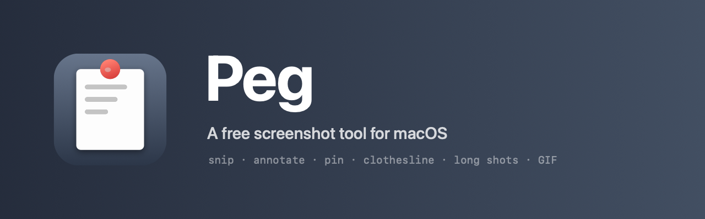

<p align="center">
  
</p>

<h1 align="center">Peg</h1>

<p align="center">
  免费开源的 macOS 截图工具。
</p>

<p align="center">
  
  
  
  
</p>

<p align="center">
  <a href="README.md">English</a>
</p>

Peg 常驻菜单栏，做的都是日常截图的事：框一块区域或一个窗口、随手标注、
把图贴在屏幕上、把长页面接成一张、录一小段 GIF。最近的截图会挂到菜单栏下面
的一条绳子上 —— 晾衣绳这个想法来自 [Tendedero](https://github.com/mrthomaswebb/tendedero)。

纯 AppKit 实现，免费使用与修改。没有账号，没有网络，没有统计，没有更新器，
只申请「屏幕录制」一个权限。

## 功能

| | |
|---|---|
| **冻结整屏再框选** | 先把每个屏幕拍成静止画面再出选区，遮罩不会进图，放大镜拿到的是真实像素。 |
| **窗口吸附** | 指针停在哪个窗口上就描出哪个，单击取整窗，按住拖动则自己框。 |
| **选区内直接标注** | 矩形、椭圆、箭头、铅笔、马克笔、文字、马赛克、模糊，八种工具直接画在冻结画面上，所见即所得。 |
| **滚动长截图** | 手动滚动，按行指纹对齐拼接，上下都能接。 |
| **GIF 录制** | 框住区域就开录，最长 20 秒、12fps，同一个快捷键结束；录的时候有红框标出范围。 |
| **晾图绳** | 最近的截图挂在一条会缓慢起伏的绳子上，每张纸下方标着拍摄时间；悬浮预览、单击复制、拖到任何 App、双击打开。想法来自 Tendedero。 |
| **贴图** | 任意截图可以浮在其他窗口之上，能拖能缩放，带阴影和描边，不会和壁纸糊在一起；剪贴板里的文字也能贴成深色代码卡片：带行号和简单语法着色，整块拖动，按住 ⌥ 可在里面选中文字。 |
| **历史** | `⌃⌥H` 浏览磁盘上的全部截图，可搜索、标注、贴图、删除。 |
| **设置** | 保存位置、PNG/JPEG 与质量、自动复制、历史保留、圆角开关、Dock 图标，以及可自定义的快捷键。 |

## 快捷键

| 按键 | 作用 |
|---|---|
| `⌃⌥X` | 截图并保存 —— 松开鼠标就已经复制并存盘 |
| `⌃⌥A` | 截图并标注 —— 框完出现工具条 |
| `⌃⌥G` | 录制 GIF —— 框住区域，再按一次结束 |
| `⌃⌥V` | 贴到屏幕：第一次贴最近一次复制的内容，再按就往回翻（图片贴成图，文字贴成卡片）；什么都没复制过时贴磁盘上最近一张 |
| `⌃⌥H` | 截图历史 |
| `⌃⌥S` | 收起 / 放下晾图绳 |

框选时：`1`–`8` 选工具，`⌘Z` 撤销，`⏎` 完成，`P` 贴图，`L` 长截图，
`Esc` 先退出工具、再按一次取消整张截图。

## 安装

Peg 没有做公证，请自己编译：

```bash
git clone https://github.com/ursasi/peg.git
cd peg
bash scripts/build-app.sh
cp -R build/Peg.app /Applications/
open -a /Applications/Peg.app
```

第一次截图会请求**屏幕录制**权限。勾选之后要重启一次 Peg —— 系统只在 App
重启后才把画面交给它。构建脚本会用找到的第一个签名身份签名，所以重新编译不会
让权限失效。

需要 macOS 14 或更新版本，以及 Swift 工具链（Xcode 或 Command Line Tools）。

## 目录结构

```
Sources/Peg
├── App         入口、菜单栏项、快捷键、权限、调试日志
├── Capture     屏幕捕获、截图会话、选区图层、窗口查找
├── Annotate    标注模型、渲染、画布、编辑器
├── Scroll      取帧、匹配、拼接与自检
├── Record      GIF 录制与 HUD/红框
├── Shelf       晾图绳面板、卡片、悬浮预览
├── Pin         置顶贴图窗口
├── History     历史窗口与保留策略
├── Settings    设置窗口与默认值
└── Support     显示器、剪贴板/存储、圆角
Tools
├── Design      App 标记，两个生成器共用
├── MakeIcon    构建时生成 AppIcon.icns
└── MakeBanner  生成 docs/banner.png
```

## 开发

```bash
swift build                 # 编译
bash scripts/build-app.sh   # 编译 + 生成图标 + 签名 Peg.app
PEG_SELFTEST=1 .build/debug/Peg   # 长截图匹配/拼接自检
PEG_DEMO=shelf|snip|overlay|settings|annotate  # 不截图直接打开某个界面
```

`PEG_DEBUG=1` 会打开测试通道：往 `/tmp/peg-cmd` 写一条命令（`snip`、`record`、
`hover:N`、`click:x,y` …），日志写到 `/tmp/peg-debug.log`。这样自动化不必伪造
全系统键盘事件。

## 已知限制

- 一次只能选一个屏幕，不支持跨屏选区。
- 长截图必须手动滚动；对不齐的帧会直接拒绝，不猜。
- 标注画上去之后不能再拖动。
- 复制 GIF 走的是剪贴板图片，粘出来是静态帧；要动图请拖文件。
- 只支持 macOS 14 以上，且没有公证。

## 许可

MIT，见 [LICENSE](LICENSE)。
